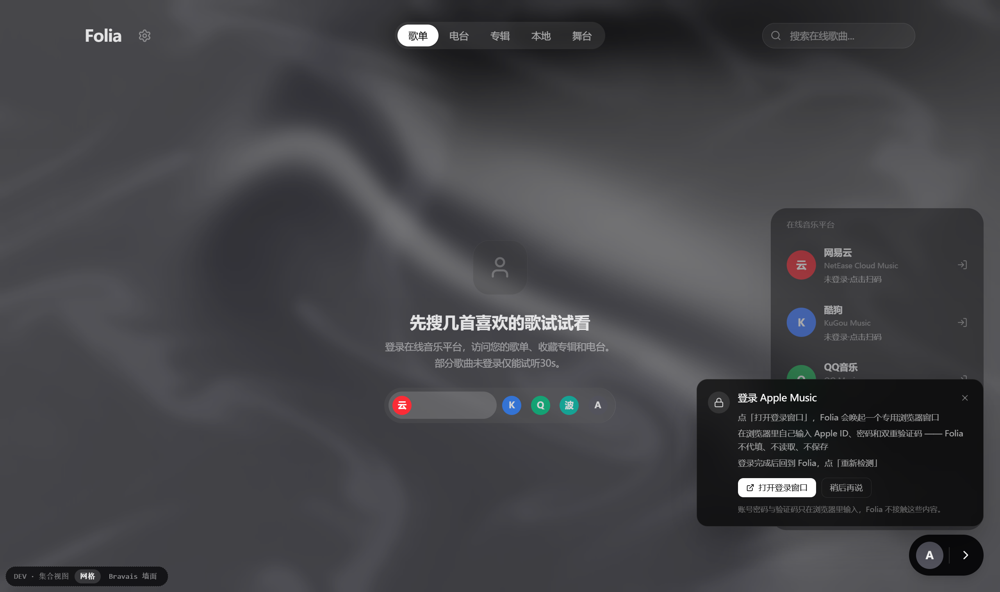

# Folia Apple Music · 非官方 Windows 衍生版

[](https://github.com/BURN1NGtree/folia-major/releases)
[](LICENSE)
[](https://github.com/BURN1NGtree/folia-major/releases)

> **一句话**：给 Windows 上听 Apple Music 的人，一个能放 Apple Music 的 Folia。
>
> 本仓库是 [chthollyphile/folia-major](https://github.com/chthollyphile/folia-major) 的**非官方修改版**。在原版已有音源之外，新增了一路 **Apple Music**。
>
> **与上游作者无隶属关系，未获 Apple 或上游的任何背书。** Apple Music 相关功能由本仓库独立实现，问题与风险也由本仓库承担，请勿找上游。

## 这个版本适合谁

| 适合 | 不适合 |
| --- | --- |
| Windows 10 / 11 用户 | macOS / Linux 用户（本版只在 Windows 实测过） |
| 有 Apple Music 订阅、想在 Folia 里听 | 没有订阅、想免费听的人（本版不提供、也无法绕过订阅） |
| 想要沉浸式歌词 + Apple Music | 想要 Apple 官方客户端专属能力（离线下载、空间音频等） |
| 愿意自己登录一次网页版 | 不愿意让本机保存登录态的人 |

如果你要的是原版的全平台安装包，请到上游：[chthollyphile/folia-major/releases](https://github.com/chthollyphile/folia-major/releases)。

## 和上游比，改了哪些地方

**以下改动全部来自本仓库，上游没有这些内容。**

| 类别 | 变化 | 你能感受到的地方 |
| --- | --- | --- |
| **新音源** | 接入 Apple Music | 来源列表多出 Apple；可搜索、看推荐、读自己的歌单与专辑 |
| **播放方式** | 由本程序启动一个**专用浏览器**访问 Apple 网页版，由它出声 | 不必安装 Apple 客户端，但要自己登录一次 |
| **窗口行为** | 后台窗口放在**屏幕外**，播放/登录时才升为可见窗口 | 听歌时不会抢前台、不占任务栏 |
| **登录引导** | 中文引导卡；不代填、不读取账号密码 | 点登录才会弹出窗口，由你自己完成登录 |
| **数据读取** | 通过浏览器调试协议读曲库 / 搜索 / 封面 / 歌词 | 歌单、专辑、歌词与网页版一致 |
| **专辑信息** | 专辑卡片补上歌手名 | 不再显示「未知歌手」 |
| **歌词** | 切到无歌词曲目时清空上一首歌词 | 纯音乐不再串上一首的字 |
| **文案** | Apple 相关提示中文化 | 不会再弹「使用网易云 APP 扫码」这类错框 |
| **稳定性** | 队列快照一致性校验、断线重连、播控等待时间自适应 | 几百首的大歌单切换时不容易卡住或误判 |

详细原理、边界与踩坑记录见 [`docs/apple-music/`](docs/apple-music/)（11 篇，含改动原理、工具清单、合规说明、发布计划）。

## 下载与安装

**最新版**：<https://github.com/BURN1NGtree/folia-major/releases>

1. 下载 `Folia-prod.rar`；
2. 解压到**纯英文路径**（例如 `D:\Folia`）。**路径含中文或空格可能导致启动失败**；
3. 双击 `Folia.exe`；
4. 按启动向导完成基础设置。

绿色免安装、不写注册表；卸载就是删除程序目录（用户数据另见下文「数据存在哪」）。

## 第一次用 Apple Music

1. 打开 Folia → 设置 → **在线音乐平台**；
2. 选择 **Apple Music** → 点「打开登录窗口」；
3. 在弹出的浏览器窗口里用**你自己的 Apple ID** 登录（密码与双重验证都在那个窗口完成，Folia 不接触）；
4. 回到 Folia 点「重新检测」，状态变成已登录；
5. 在来源里选 Apple，即可搜索与播放。

<p align="center">
  
</p>

登录态保存在本机的专用浏览器 profile 中，**下次启动无需重新登录**（除非你清理了该目录）。

## 界面

专辑页会显示歌手名（上游原版此处为空）：

<p align="center">
  
</p>

## 保留的上游能力

本版**没有删减**上游任何原有能力，只是增加了 Apple Music：

| 模块 | 说明 |
| --- | --- |
| 在线音源 | 网易云、QQ、酷狗、酷我、波点 |
| 本地音乐 | 导入本地音频、同目录歌词（`.lrc` / `.vtt` / `.ttml` / `.qrc` / `.yrc` / `.krc`）与内嵌歌词 |
| 沉浸式歌词 | 全屏歌词、多种动画与可调参数、AI 生成配色 |
| Now Playing | 通过本机 Now Playing 服务接入外部播放器的时间轴与歌词 |
| 模组系统 | Folium v1.x（实验性，桌面版，默认关闭） |
| Web / 自托管 | Web 版、Docker、Sync Server 等（见上游文档） |

这些能力的实现、文档与设计归上游作者与贡献者所有，使用说明请直接看上游仓库与[上游文档](https://folia-site.cielaniska.top/guide/)。

## 系统要求

- **Windows 10 / 11（x64）**，本版仅此平台实测；
- 有效的 **Apple Music 订阅**（地区、家庭共享、学生订阅等差异会影响行为）；
- 能正常访问 `music.apple.com`（网络受限时登录会失败）；
- 无需预装 Apple Music 客户端、iTunes 或任何虚拟机。

## 与上游、与 Apple 的关系

- **与上游**：本仓库是 fork，完整保留上游代码与其 `LICENSE`（AGPL-3.0，逐字节未改）。**上游作者未参与本版本的开发，也不为其负责**；请勿到上游仓库或社区报本版的问题。
- **与 Apple**：无任何关系。本版不含 Apple 的代码、不代理 Apple 服务、不提供账号或订阅、不破解 DRM、不下载或再分发音频。播放走的是 Apple 自己的网页播放器。
- **风险提示**：自动化操作第三方网页属于 Apple 条款的灰色地带，账号存在被限制的可能，**风险由使用者自行承担**。详见 [`DISCLAIMER.md`](DISCLAIMER.md)。

## 许可与源码（AGPL-3.0）

- 本版按 **AGPL-3.0** 分发，`LICENSE` 原样保留；
- 你可以自由使用、修改、再分发，但**分发时必须同样以 AGPL-3.0 提供完整对应源码**并保留版权声明；
- 对应源码：本仓库 `v0.7.20-apple.1` 标签，或 Release 附件中的 `folia-major-src.tar.gz`；
- 相对上游的完整改动：Release 附件 `folia-major-changes.patch`（89 文件，可直接审计）；
- 上游版权归原作者与贡献者；本版新增部分归本仓库维护者。详见 [`NOTICE`](NOTICE)。

## 数据存在哪

| 内容 | 位置 | 说明 |
| --- | --- | --- |
| 应用数据（设置、缓存、曲库索引） | `%APPDATA%\Folia` | 删除后回到初始状态 |
| Apple 登录态（专用浏览器） | `%LOCALAPPDATA%\FoliaAMProfile` | **等同于账号登录态**，请按敏感数据对待；删除后需重新登录 |
| 程序本体 | 你解压的目录 | 绿色版，删目录即卸载 |

## 常见问题

**点播放后进度在走却没声音？**
先确认系统音量与输出设备，再确认 Apple 已登录。本版后台浏览器窗口在屏幕外属正常现象，播放时应有声音。仍无声请提 Issue 并附日志。

**点登录没反应，或窗口跑到屏幕外？**
稍等 1–3 秒——本版需要切换浏览器实例。若一直无窗口，检查杀毒软件是否拦截了子进程。

**启动后直接退出、没有任何提示？**
多半是路径含中文/空格，或已有实例在运行。换到 `D:\Folia` 这类纯英文路径，并确认任务管理器里没有残留 `Folia.exe`。

**Apple 页面提示不可用 / 登录失败？**
先确认网络能访问 `music.apple.com`；部分地区需要相应网络环境。这类问题不属于本程序的缺陷。

**会不会导致 Apple 账号被封？**
存在这种可能（目前未收到相关反馈）。这是使用本版的主要风险，请自行判断是否接受，见 `DISCLAIMER.md`。

**能出 macOS / Linux 版吗？**
源码可构建，但本仓库只在 Windows 验证过；其他平台需自行处理浏览器路径与窗口行为差异，不保证可用。

## 从源码构建（Windows）

```bash
git clone https://github.com/BURN1NGtree/folia-major.git
cd folia-major
git checkout release/fork-apple
npm ci

# 关键：必须带 ELECTRON=true，否则产物引用绝对路径，打包后白屏
ELECTRON=true npx vite build

# 离线打包（复用本机 Electron；跳过签名与 exe 改写）
npx electron-builder --dir --win \
  -c.electronDist=node_modules/electron/dist \
  -c.win.signAndEditExecutable=false
```

产物在 `release/win-unpacked`。两个常见坑：

- `beforePack` 需要 `build/ffmpeg/win-x64` 下的 ffmpeg 资产，缺失会报 `fetch failed`（先准备 `node_modules/electron/dist` 与 ffmpeg 缓存）；
- 不要用 `asar extract-file`——它会把文件写到当前工作目录，可能覆盖源码。

## 致谢

- 上游项目：[chthollyphile/folia-major](https://github.com/chthollyphile/folia-major) 及其全部贡献者（贡献者名单见上游 `CONTRIBUTORS.md`）；
- 上游依赖与数据来源（含 LDDC、NeteaseCloudMusicApiEnhanced、KuGouMusicApi、qq-music-api、shaders、pretext、AMLL TTML 歌词库等）归各自作者所有；
- 本仓库只做了 Apple Music 接入与 Windows 打包这一层工作，其余能力均为上游成果。

## 反馈

- 与本版（Apple Music 音源、Windows 打包）相关的问题：**请在本仓库提 Issue**
  <https://github.com/BURN1NGtree/folia-major/issues>
- 提 Issue 时请附：版本标签、Windows 版本、复现步骤、日志（启动加 `--enable-logging`）；
- **请勿在上游仓库或其社区询问本分支的问题**——上游作者不负责本版，也未曾参与它的开发。

## 许可证

本项目基于 [`AGPL-3.0`](LICENSE) 开源。
