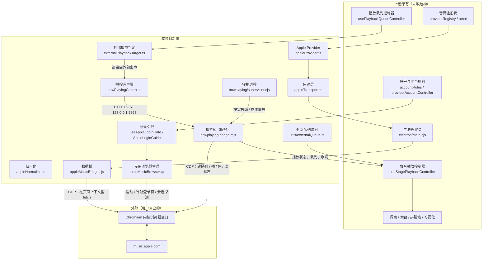

# 03 · 改动原理（可复刻版）

**适用版本：`v0.7.20-apple.1`**（上游基底提交 `103be0af`）

> 一句话摘要：把 Apple Music 网页端当成一台「被遥控的播放器」——数据靠专用浏览器的页面上下文取，播放靠 CDP 指挥同一个页面，Folia 只在两端做映射；本篇写到能照着复刻的程度，包括所有踩过的坑与放弃过的方案。

---

## 1. 总体架构



**一句话理解两条链路：**

| 链路 | 方向 | 形态 |
| --- | --- | --- |
| 数据链路 | Folia → 主进程桥 → 页面上下文 fetch → Folia | 单次 IPC 往返，同步式 |
| 播放链路 | Folia → 播控桥（HTTP）→ 页面内 MusicKit → 回读状态 → Folia | 命令 + 轮询，异步式 |

---

## 2. 数据链路：怎么把 Apple 的数据变成上游能吃的形状

### 2.1 分层与职责

```
appleProvider.ts      ← 实现上游 OnlineProvider 契约（语义层）
      ↓
appleTransport.ts     ← 唯一 IPC 通道：操作白名单、参数边界、错误码翻译
      ↓ (preload: appleMusicRequest)
electron/main.cjs     ← ipcMain.handle('apple-music-request')，再做一次白名单校验
      ↓
appleMusicBridge.cjs  ← 真正发请求的地方：在浏览器页面上下文里执行，拿到 JSON
      ↓
appleNormalize.ts     ← 把 data[] + attributes 映射成 OnlineSong/Album/Playlist
```

### 2.2 为什么请求要在「页面上下文」里发

Apple 的 Web 接口需要用户会话（Cookie）与页面同源上下文。两种错误做法：

1. **在 Node 里直连** —— 实测返回 `401`：缺少浏览器侧的会话与签名参数。
2. **在渲染进程里 `fetch`** —— 会被跨域策略拦下，且拿不到用户会话。

所以数据桥的做法是：通过 CDP 连上专用浏览器页面，在那个页面里执行一段 `fetch`，把结果转成 JSON 回传。好处是会话、同源、请求头全部天然正确；代价是必须有一个活着的浏览器进程（这也是为什么「数据」和「播放」共用同一个浏览器）。

### 2.3 操作白名单（防漂移的关键设计）

`appleTransport.ts` 导出 `APPLE_OPERATIONS` 常量，主进程与播控桥各自持有一份同样的白名单；单测直接读桥里的常量做**漂移比对**，改一边忘另一边会立刻失败。

```ts
// 只读语义：这些操作名必须与主进程逐字一致
export const APPLE_OPERATIONS = [
  'session', 'ping',
  'library_playlists', 'library_playlist_detail', 'library_playlist_tracks',
  'library_songs', 'library_albums', 'library_album_detail', 'library_album_tracks',
  'library_artists', 'recent_played', 'me_recommendations',
  'catalog_search', 'catalog_song', 'catalog_album', 'catalog_artist',
  'catalog_playlist', 'catalog_playlist_tracks', 'song_lyrics',
] as const;
```

> 深度开发者注意：新增能力时**三处一起改**——白名单、主进程 switch、单测期望。漏掉主进程那处会得到 `unknown operation`，漏掉单测那处 CI 不报错但下次桥升级会漂移。

### 2.4 归一化：映射到上游的数据结构

上游的在线音源统一模型是 `OnlineSong / OnlineAlbum / OnlinePlaylist`（字段见 `src/types/onlineMusic.ts`）。Apple 的响应是 `{ data: [{ id, type, attributes }] }`，映射规则集中在 `appleNormalize.ts`：

| Apple 字段 | 上游字段 | 说明 |
| --- | --- | --- |
| `id`（catalog 或 library id） | `providerData.catalogId` 等 | 需要区分 catalog 与 library 两套 id |
| `attributes.name` / `title` | `title`/`name` | 逐字段取，缺失不乱猜 |
| `attributes.artistName` | `artists[]`（type=album 时） | 只对专辑填，且**不**按 `&`/`feat.` 拆，避免破坏组合名 |
| `attributes.artwork.url` | `coverUrl` | 需要替换尺寸占位符（`{w}`×`{h}`） |
| `attributes.durationInMillis` | `duration` | 毫秒 → 秒 |
| `attributes.playParams.id` | 播放用 catalogId | 播放时用它建队列，不是列表 id |

**踩坑**：专辑卡片一开始全显示「未知歌手」，原因是 `normalizeAppleCollection` 只把 `artistName` 塞进 `providerData`，没填 `artists`；而卡片组件 `getProviderCollectionArtistLabel` 只读 `artists`。修法是一行映射 + 两条单测（含 `Simon & Garfunkel` 这种不能拆的名字）。

### 2.5 分页与截断

Apple 侧对单次返回有上限（实测 100）。本项目把「压上限」的动作放在**桥里**（`clampLimit`），前端不重复压，避免两处各有一套上限导致「看起来能翻页但实际重复拿同一页」。

---

## 3. 播放链路：怎么让 Apple 的网页真正出声

### 3.1 为什么不能让 Folia 自己播

Apple Music 音频受 DRM 保护，浏览器里只有 Apple 自己的播放器能解。所以本项目的分工是：

- **Apple 自己的网页实例**负责出声；
- **Folia** 负责发送指令、读回状态、把状态画到自己的界面。

### 3.2 指令怎么到网页

```
Folia 渲染进程 (nowPlayingControl.ts)
  └─ HTTP POST http://127.0.0.1:9863/…  ← 本机回环，带命令与参数
        └─ 播控桥 (nowplaying/bridge.mjs)
              └─ CDP 连到 music.apple.com 页面
                    └─ 在页面里调用 MusicKit：setQueue / changeToMediaAtIndex / play / pause / skipToNext…
```

桥是独立 Node 进程，由 `supervisor.cjs` 用 `utilityProcess.fork` 拉起（**不是**随 app 无条件启动：只有真的用到 Apple 能力时才 `ensureStarted`）。守护逻辑：崩溃按 1/2/4/8/30 秒退避重启；端口 9863 已被占用则视为「已有外部实例」，让位不抢。

### 3.3 建队列：为什么必须「先把队列建对，再定位」

这是本项目最关键的实现细节，也是踩坑最多的地方：

```js
// 播控桥内（简化）
await mk.setQueue({ album: albumId });           // 建整张专辑队列
const items = mk.queue.items;                    // 队列顺序可能与列表顺序不同
const index = items.findIndex(/* 目标曲 */);
await mk.changeToMediaAtIndex(index);
await mk.play();
```

对应 `bridge.mjs` 的三段注释（约 337–426 行）：

| 现象 | 原因 | 解法 |
| --- | --- | --- |
| 用 `setQueue({ song })` 播一首后，「上一首/下一首」不可用 | 单曲队列长度为 1，`nextPlayableItemIndex`/`previousPlayableItemIndex` 均为 -1 | 用 `{ album }`、`{ songs }`、`{ playlist }` 建**多曲队列**，再 `changeToMediaAtIndex` 定位 |
| `startWithSong` 选项不起作用 | 建完队列后 position 仍是 -1 | 不用该选项，自己读 `queue.items` 找 index 再跳 |
| 建完队列不自动开播 | MusicKit 的 `setQueue` 只建队列 | 每次 `setQueue` 之后必须显式 `play()`（电台还会"自己开播"一次，不能假定） |
| 歌单几百首时点播放等十几秒 | 逐首解析 catalogId + 建队列，耗时随长度线性增长 | 前端把整条队列的 id 一次送来；桥按长度放宽「生效判定窗口」；超时不再整条重发（旧逻辑重发导致双倍等待） |

### 3.4 「命令是否生效」的判定窗口

播控桥发完命令后会轮询页面状态，确认「真的变了」才算成功。窗口固定 8 秒在大队列上会导致**假阴性**（命令其实生效了，只是还没跟上），随后前端重发整条队列，耗时翻倍。

```js
// bridge.mjs 约 858 行
const windowMs = Math.min(30000, 8000 + Math.max(0, ids.length - 20) * 40);
```

实测（本机）：17/22/34/99/169/486 首 → 2.3 / 3.5 / 4.1 / 6.4 / 2.5 / 4.0 秒（169 与 486 因命中缓存而更快）。477 首首次冷启动约 10 秒以上——这是「已知问题」里的延迟来源。

### 3.5 状态回灌：让 Folia 以为自己正在播放

上游的舞台控制器只接受自家播放源。本项目没有硬改它，而是**放开三个门控 + 增加一个发布条件**：

```ts
// useStagePlaybackController.ts:186-191（简化）
const isNowPlayingStageActive = activePlaybackContext === 'stage' && stageSource === 'now-playing';
const externalMirrorActive = !isNowPlayingStageActive && Boolean(resolveAppleCatalogId(currentSong));
const shouldPublishNowPlayingState = isDev || isNowPlayingStageActive || externalMirrorActive;
```

三处 `stageSource !== 'now-playing'` 的提前返回（约 1051、1137 行）各加一个 `&& !externalMirrorActive`。**为什么选这种接法**：这是侵入面最小的方案——不改上游状态机，只让它「以为」外部播放器也是合法来源之一；代价是这三处是同步上游时最容易冲突的地方（见第 6 节）。

### 3.6 队列与拼贴墙的对应关系

Folia 的队列与 Apple 的队列不是同一份数据：Folia 侧记录 `track.queueItemIds`（Folia 认为的队列），Apple 侧有 `queue.items`（真实队列）。`src/utils/externalQueue.ts` 负责把两边对齐：

- 按 catalogId 建立「Folia 曲目 ↔ Apple 队列位置」的映射；
- 位置变化时，用 Apple 的 `nowPlayingItem` 兜底，避免因 id 形式差异（catalog / library）对不上；
- 一致性检查：每 350ms 读一次快照，最多比 3 次；连续 5 次对不上就重建 CDP 连接（而不是死循环重试）。

**踩坑**：曾因 `refreshQueueSnapshot()` 重构时丢了 `finally`，`queueSnapshotLoading` 永久挂起，快照冻结在 27 首，拼贴墙不跟随（Folia 想的队列已是 477 首）。教训——所有「加载中」标志位必须用 `promise.finally()` 释放，不能手动在两处 `set`。

### 3.7 队列控制只镜像两个开关

Apple 侧与「待播清单」相关的控制只有四个：随机开关、循环三态（关闭/列表/单曲）、清空待播、无限播放。本项目**只镜像前两个**（`mapFoliaLoopToExternal` / `mapExternalLoopToFolia`），后两个 Folia 没有对应功能，不推断、不干扰。

> 推论：`setQueue` 本身等价于用户按了「清空待播」，所以断言队列长度时不能写死——若 Apple 侧开了「无限播放」，长度会自己增长。

---

## 4. 登录与会话

### 4.1 流程

```
用户点「Apple」→ accountRules 判定 provider==='apple' 且未登录 → 返回 { kind: 'apple-login' }
   → providerAccountController 调 deps.onAppleLoginRequired() → App 转发给登录引导卡
   → 引导卡按钮「打开登录窗口」→ appleMusicBrowser.ensure()
   → 启动/复用专用浏览器并导航到 Apple 登录页
   → 用户在浏览器里自己完成登录（含二次验证）
   → 回到 Folia 点「重新检测」→ 浏览器会话探测（只看是否已登录，不读凭据）
```

为什么要改道：上游的平台列表默认走「扫码登录」通用流程，Apple 没有二维码，结果会弹出「使用网易云 APP 扫码」的错误弹窗。改法是在选择结果里新增一个类型：

```ts
// accountRules.ts（简化）
if (provider.providerId === 'apple' && !provider.signedIn) return { kind: 'apple-login' };
```

### 4.2 会话怎么维持

- 专用浏览器使用**独立用户目录**（profile），登录态存在浏览器的 Cookie 里，本项目不读取、不导出；
- 判断「是否已登录」用一次轻量的会话探测（`apple-music-browser-probe`），只看有没有有效会话；
- 「清除会话」= 调 `apple-music-browser-clear-session`，让浏览器清掉该站点的 Cookie，不触碰其他站点；
- 关闭 Folia 时结束专用浏览器进程（可配置为保留，取决于你的部署方式）。

### 4.3 为什么必须「可见」

实测：标签页处于 hidden 状态时，`isPlaying` 为真但 `currentTime` 不动——Apple 的播放推进依赖页面可见性。因此：

- 浏览器默认以**可见**窗口启动（不用无头）；
- 播控前对页面做「解冻 + 焦点仿真」（`Page.setWebLifecycleState('active')` + `Emulation.setFocusEmulationEnabled`），让页面认为自己是激活的；
- **不要**为了「不打扰用户」改成无头——会直接不推进播放。

### 4.4 不抢焦点的实现

早期每次播控都调 `Page.bringToFront`，导致点播放时 Apple 窗口弹到最前面。修法：

1. 删掉 `bringToFront`，改焦点仿真（窗口不动，页面内仍认为激活）；
2. 浏览器启动参数关闭后台节流：`--disable-renderer-backgrounding`、`--disable-background-timer-throttling`、`--disable-backgrounding-occluded-windows`，并加 `--disable-features=…,CalculateNativeWinOcclusion`（避免「被遮挡即降频」）。

> 若某天实测「最小化后播放停住」，说明 Apple 改了可见性判定，再退回 `bringToFront`（代码里留了注释说明这一点）。

---

## 5. 踩坑记录（现象 → 原因 → 解法 → 放弃的方案）

| # | 现象 | 原因 | 最终解法 | 放弃过 / 没采用的方案 |
| --- | --- | --- | --- | --- |
| 1 | 拼贴墙不跟随队列，一直显示 27 首 | 快照加载标志位没释放，`finally` 丢失 | `promise.finally()` 释放；连续 5 次对不上就重建连接 | 定时强制刷新（会与真实状态打架） |
| 2 | 点播放要等十几秒，日志显示「未生效」后重发 | 固定 8 秒判定窗口对大队列太短 → 假阴性 → 整条重发 | 窗口按队列长度放宽（上限 30s）；超时不再重发 | 无限等（界面卡死）；把窗口缩到 1.6s（误判更多） |
| 3 | 「上一首/下一首」在播 Apple 歌时不可用 | 用 `setQueue({song})` 建了单曲队列 | 用专辑/歌单/曲目集合建多曲队列，再按下标跳 | 播放后手动插入相邻曲（无法维护） |
| 4 | 播控时 Apple 窗口弹到最前 | 每次调用 `Page.bringToFront` | 改焦点仿真 + 关后台节流参数 | 隐藏浏览器（播放不推进）；无头（同上） |
| 5 | 播放时进度条不动 | 页面被判定为 hidden | 可见窗口 + 生命周期置 active | 定时 `bringToFront`（抢焦点） |
| 6 | 打包产物在某目录下双击闪退、无日志 | 可执行文件路径含非 ASCII 字符，Electron 无法加载 | 放到纯 ASCII 路径运行 | 改安装目录名（用户不可能都照做，属已知限制） |
| 7 | 专用浏览器 profile 涨到 1.4 GB | 完整 Chromium profile：扩展、缓存、组件缓存、ML 模型 | 启动参数关扩展/组件更新/同步 + 定期清理缓存类目录（保留 Cookie 与站点数据） | 用临时 profile（每次都要重登）；共享主浏览器 profile（污染用户浏览器） |
| 8 | 端口 9863 被占用导致重复启动 | 多个实例/残留进程 | 守护进程发现端口占用即视为「外部实例」，让位不抢 | 强杀占用进程（会误杀其他程序） |
| 9 | 关闭 Folia 后仍有 node 进程残留 | 子进程未随父进程退出 | `before-quit` 显式 `stop()`；守护进程负责 kill | 依赖父进程退出时自动回收（Windows 不可靠） |
| 10 | 专辑卡片全是「未知歌手」 | 归一化没填 `artists`；卡片只读 `artists` | 归一化补字段（不拆分组合名） | 在卡片层回退读 `providerData`（把兼容逻辑撒到 UI 层） |
| 11 | 纯音乐切到有人声的歌，首句歌词残留 | 外部歌词来源是「追加」而非「替换」 | 切歌时先清空歌词与当前行索引再加载 | 只换 key 不清理（残留仍在） |
| 12 | 专用浏览器窗口数量/页面混乱 | 复用了用户日常浏览器或旧页面 | 独立 profile + 固定导航登录页 + 复用同一 target | 每次新建窗口（登录态与播放器实例都对不上） |

---

## 6. 与上游同步的策略

### 6.1 原则

> 上游代码只做「增量注入点」，Apple 逻辑尽量放独立文件。

现状评估：新增文件 28 个（独立、几乎不会冲突），修改上游文件 45 个（这些是冲突源）。控制冲突的手段：

| 手段 | 做法 |
| --- | --- |
| 分支隔离 | `main` 只跟随上游；`apple` 放改动；合并时从 `main` 合入 `apple` |
| 提交粒度 | 每个上游文件的修改单独成提交，冲突时看得懂「为什么改这一行」 |
| 门控集中 | `stageSource !== 'now-playing'` 这类门控处尽量只加一个布尔条件，不重写整个函数 |
| 契约固定 | 新 Provider 只实现上游契约，不改契约本身（改契约会让所有音源一起变） |
| 回归清单 | 每次同步后跑 `typecheck` + 单测 + 第 07 篇第 5 节的冒烟项 |

### 6.2 同步步骤

```bash
git fetch upstream --tags
git checkout main && git merge upstream/main
git checkout apple && git merge main        # 冲突集中在被修改的上游文件
npm ci && npm run typecheck && npm run test:unit
# 冒烟：登录态、搜索、单曲播放、歌单播放、切歌、拼贴墙跟随、关闭清理
```

冲突高发文件（按历史经验）：`useStagePlaybackController.ts`、`usePlaybackQueueController.ts`、`App.tsx`、`providerRegistry.ts`、`main.cjs`。

### 6.3 上游大改时的退路

如果上游重构了播放层（例如把播放后端抽象化），优先**采用上游抽象**、把 Apple 实现迁移成新接口的实现类，而不是继续加门控。这类迁移是「一次大改换长期低成本」，值得专门排期。

---

## 7. 已知限制与替代方案

| 限制 | 具体表现 | 已经验证的替代/缓解 | 为什么没采用（或为什么只能这样） |
| --- | --- | --- | --- |
| 大队列首次播放慢 | 477 首约 10s+ | ① 让 Apple 用歌单 id 自己展开（`setQueue({ playlist })`），跳过逐首解析 | 未采用：会重置当前队列并打断正在播放的歌；且需处理歌单与 Folia 队列顺序差异（用户当时选择保持现状） |
| | | ② 提前建队列（进歌单页就 `setQueue` 但不播） | 同上：替换队列会中断当前播放 |
| Apple 逐字歌词未解析 | 只有整行 | 桥里已有 TTML 时间解析（`parseTtmlTime`），可映射成逐字时间轴 | 未接入 UI：需要改上游歌词渲染结构，属另一块工作量 |
| 混合队列 | Apple 曲目与本地曲目混排未验证 | 拆成两段分别播放（先 Apple 段、再本地段） | 未验证可行性；上游队列模型假设单一生效源 |
| 不能离线 | 必须联网 + 登录 | 无 | DRM 决定；本项目不做解密/下载 |
| 依赖 Apple 网页结构 | Apple 改版即失效 | 所有选择器与调用集中在桥里，改动面小 | 无法根除，只能跟随适配 |
| Windows 路径限制 | 非 ASCII 路径闪退 | 放纯 ASCII 路径；或设 `ELECTRON_OVERRIDE_DIST_PATH` 指向 ASCII 目录的运行时 | 这是 Electron 自身行为，仓内无法修复 |
| 无头模式不可用 | 无头下播放不推进 | 用可见窗口 + 关后台节流 | 见 4.3，属 Apple 侧可见性判定 |

**关于「不用 CDP」的替代路线（供深度开发者参考）：**

| 路线 | 为什么没走 |
| --- | --- |
| 官方 MusicKit JS + Developer Token | 需要 Apple Developer 账号与私钥签名，且网页端 token 与「用户自己的订阅会话」是两套东西，不能直接复用用户登录态 |
| 直连 Apple 私有接口 | 实测 `401`：需要浏览器侧的会话与签名参数，Node 侧拿不到 |
| 模拟点击（坐标/图像识别） | 界面一变就崩，且无法可靠读取队列与位置 |
| 系统媒体键 / 音频回环抓取 | 只能控制「当前在放什么」，无法建队列、无法读队列，满足不了 Folia 的队列与拼贴墙需求 |

---

## 8. 给「想接别的音源」的人的复用点

| 复用点 | 文件 | 怎么改 |
| --- | --- | --- |
| 数据桥范式（浏览器页面内 fetch + 白名单 IPC） | `appleMusicBridge.cjs` + `appleTransport.ts` | 换接口路径与归一化即可，白名单机制照搬 |
| 播控桥范式（CDP 指挥网页播放器） | `nowplaying/bridge.mjs` | 把 `MusicKit` 调用替换成目标站的播放器 API；状态表达式换成读目标站的状态 |
| 外部播放判定与镜像 | `externalPlaybackTarget.ts` + `useStagePlaybackController.ts` 的门控 | 把 `resolveAppleCatalogId` 换成「该曲是否由目标外部源出声」 |
| 会话与登录引导 | `appleMusicBrowser.cjs` + `useAppleLoginGate.ts` | 登录 URL、会话探测、引导文案替换 |
| 服务守护 | `nowplaying/supervisor.cjs` | 与音源无关，可原样复用（改端口与脚本路径） |

---

## 9. 自检结果

**TODO：**

| 位置 | TODO | 需要你补 |
| --- | --- | --- |
| 3.3 / 3.4 | 具体耗时随机器与网络变化 | 你本机的实测数字（我写的是本项目记录值） |
| 3.4 | 477 首冷启动耗时只记录到「10 秒以上」 | 精确值（若有日志） |
| 3.6 | 一致性检查参数（350ms × 3 次、5 次失败重建）来自实现记录 | 若你后来改过参数，告诉我更新 |
| 4.2 | 「关闭 Folia 时结束专用浏览器」是否符合你的部署意图 | 你的取舍（保留会话 vs 每次重登） |
| 5.#7 | profile 清理的具体目录清单 | 你实际清理过的目录列表，我按「缓存类」概述 |
| 7 | 混合队列的替代方案 | 你是否真的试过「分两段播放」 |

**本篇无编造项**：文件、函数名、行号来自实际代码检索（`bridge.mjs` 337–426、858、805–815；`useStagePlaybackController.ts` 186–191、1051、1137；`externalPlaybackTarget.ts` 10/26/32/41/61；`main.cjs:5926`）；耗时为本项目记录值并标注「实测」；替代方案中「未采用」的均写明原因，未采用的方案不表述为已实现。
